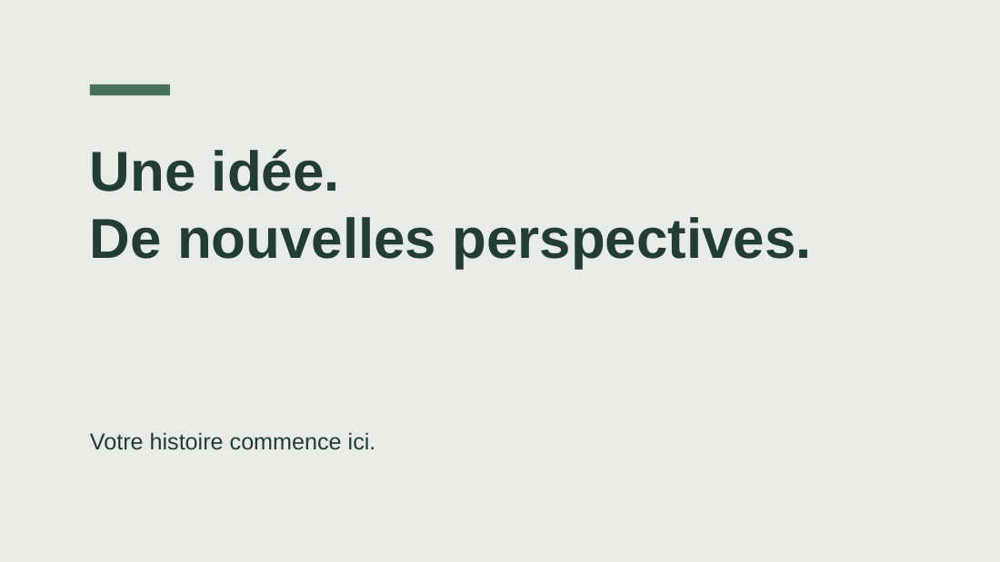

# Clair Office

**De la place pour vos idées.** Une suite bureautique libre pour écrire et présenter, avec une interface commune en français, des fichiers locaux et un moteur de conversion Office optionnel.

[](https://github.com/Frozalex/clair-office/actions/workflows/ci.yml)  

Clair Office est un projet indépendant. Son code applicatif et son design sont originaux, construits sur Tiptap/ProseMirror, PptxGenJS, docx et Mammoth. Il n’est ni affilié à Microsoft ni une version complète de Word ou PowerPoint.

## Démarrer

Node.js **22.12+** (24 LTS conseillé) et npm :

```bash
git clone https://github.com/Frozalex/clair-office.git
cd clair-office
npm ci
npm run dev
```

Ouvrir l’URL indiquée par Vite, normalement **http://127.0.0.1:5173**.

```bash
npm run check       # TypeScript et tests
npm run build       # application statique dans dist/
npm run preview     # vérifier la version compilée
```

L’éditeur fonctionne sans compte ni service distant. Après installation, les ressources de l’application sont servies localement ; aucun CDN de police ou service analytique n’est utilisé. Cette version n’est pas encore une PWA installable.

## Ce que la version 0.1 permet

- **Écrire** : titres, texte riche, listes, liens, citations, images, tableaux, alignement, surlignage, plan du document, annulation et rétablissement.
- **Présenter** : diapositives 16:9, textes, formes, images, déplacement à la souris ou au clavier, tailles et positions précises, quatre palettes, ordre des calques, notes et mode présentation.
- **Passer d’un document à une présentation** : une première diapositive par section, à ajuster avant présentation.
- **Organiser** : modèles, recherche, favoris, duplication, renommage et suppression avec confirmation.
- **Sauvegarder** : automatiquement dans le navigateur, export et réimport `.clair`.
- **Exporter** : DOCX et PPTX modifiables, impression / PDF du navigateur.
- **Importer Office** : copie modifiable DOCX/PPTX ; DOC/PPT/ODT/ODP/RTF normalisés par LibreOffice avant import.
- **Convertir l’original** : DOC, DOCX, PPT, PPTX et formats ouverts, sans passage par l’éditeur simplifié.

### Conversion Office locale

Installer **LibreOffice** et **Python 3.11+**, puis, dans un second terminal :

```bash
python3 server/converter.py
```

Le compagnon écoute uniquement sur `127.0.0.1:8765`. Vite relaie `/api` vers ce service. Aucun paquet Python n’est nécessaire. Le serveur détecte `libreoffice` ou `soffice` dans le PATH. Un chemin explicite est possible :

```bash
CLAIR_SOFFICE=/chemin/vers/soffice python3 server/converter.py
```

Sous Windows PowerShell, définir `$env:CLAIR_SOFFICE` vers `soffice.exe`, puis lancer le script Python. Sous macOS, utiliser `/Applications/LibreOffice.app/Contents/MacOS/soffice`.

Sans ce moteur, l’éditeur, l’import DOCX/PPTX et les exports DOCX/PPTX/Clair restent utilisables. Les conversions historiques DOC/PPT nécessitent LibreOffice. Le moteur n’est pas fourni dans le dépôt.

## Formats et fidélité

**Aucune conversion vers « n’importe quelle extension sans dégradation » n’est possible.** Le contenu éditable, l’apparence, les animations et les macros sont des propriétés distinctes. Clair garde l’original intact et annonce les limites avant l’import ou la conversion.

| Fichier         | Copie modifiable dans Clair                         | Conversion directe de l’original    | Limites principales                                                                         |
| --------------- | --------------------------------------------------- | ----------------------------------- | ------------------------------------------------------------------------------------------- |
| `.clair` v1     | Oui                                                 | Export natif                        | Fidélité des propriétés prises en charge par Clair ; pas d’objets Office cachés             |
| `.docx`         | Texte/structure avec Mammoth                        | DOC, DOCX, ODT, PDF, RTF, TXT, HTML | Pagination, champs, en-têtes et éléments complexes non repris par l’éditeur                 |
| `.doc`          | Via DOCX et LibreOffice                             | Mêmes destinations que DOCX         | Ancien format binaire ; contrôlez le résultat                                               |
| `.pptx`         | Texte, rectangles, ellipses, images PNG/JPEG, notes | PPT, PPTX, ODP, PDF                 | Styles hérités, masques, groupes, graphiques, animations et rotations simplifiés ou ignorés |
| `.ppt`          | Via PPTX et LibreOffice                             | Mêmes destinations que PPTX         | Ancien format binaire ; contrôlez le résultat                                               |
| `.odt` / `.rtf` | Via DOCX et LibreOffice                             | Famille document                    | Différences entre modèles de mise en page                                                   |
| `.odp`          | Via PPTX et LibreOffice                             | Famille présentation                | Différences entre moteurs de rendu                                                          |
| `.pdf`          | Pas d’import éditable                               | Destination seulement               | Lecture figée, sans animations ni édition Office                                            |
| `.txt`          | Pas d’import dans cette version                     | Destination document                | Toute mise en forme est supprimée                                                           |
| `.html`         | Pas d’import dans cette version                     | Archive ZIP avec HTML et ressources | Ouvrir le HTML après extraction de l’archive                                                |

Une conversion **vers le même format** retourne les octets originaux sans modification. Pour les autres conversions, le fichier source n’est jamais remplacé. Les polices installées sur la machine du convertisseur influencent le résultat. L’aperçu PDF sert au contrôle visuel, pas à prouver une identité avec le rendu Microsoft Office.

Voir [la politique de fidélité](docs/FORMAT_FIDELITY.md) et [les bases techniques comparées](docs/ARCHITECTURE.md).

## Design et accessibilité

Deux ateliers, un vocabulaire commun : des commandes familières, une palette sauge et papier, une navigation sobre et des panneaux contextuels. Thèmes clair/sombre, affichage adaptable, noms accessibles des commandes, focus visible, raccourcis et préférence de mouvement réduit sont prévus.

L’accessibilité n’a pas encore fait l’objet d’un audit WCAG complet. Il reste à tester l’interface sur plusieurs navigateurs, lecteurs d’écran, écrans tactiles et niveaux de zoom. La vue document est continue, pas un moteur WYSIWYG de pagination Word.

| Raccourci               | Action                                        |
| ----------------------- | --------------------------------------------- |
| Ctrl / Cmd + K          | Rechercher un fichier                         |
| Ctrl / Cmd + S          | Télécharger une sauvegarde Clair              |
| Ctrl / Cmd + Z          | Annuler dans l’éditeur                        |
| Ctrl / Cmd + Maj + Z    | Rétablir                                      |
| Flèches sur un élément  | Déplacer l’élément de diapositive             |
| Maj + flèches           | Déplacer plus vite                            |
| Flèches en présentation | Changer de diapositive                        |
| Échap                   | Fermer une fenêtre ou quitter la présentation |

## Stockage et limites de cette alpha

Les données sont enregistrées dans `localStorage` sur **ce navigateur et cette origine**. Elles ne sont pas synchronisées avec GitHub ou un cloud. Vider les données du navigateur les supprime. Le quota dépend du navigateur, souvent quelques Mo : les échecs de sauvegarde sont affichés. Exportez régulièrement chaque fichier en `.clair` et gardez vos originaux Office séparément. Une copie Clair ne contient pas le fichier Office original.

Utiliser une seule fenêtre d’édition à la fois. Pas encore de collaboration, suivi des modifications, commentaires, sauvegardes automatiques versionnées, chiffrement applicatif ou gestion complète des objets Office. Limites : 200 fichiers par espace, 200 diapositives par présentation, 100 éléments par diapositive ; import Clair/Office 12 Mo (DOCX direct 8 Mo), conversion 20 Mo. Ne pas confondre ces plafonds et le quota réel du navigateur.

## Vérification

Les tests couvrent les formats natifs, les erreurs de stockage, la sanitation HTML, les imports DOCX/PPTX, les exports OOXML, les proportions des images et les parcours d’interface dans un DOM simulé. Le compagnon Python possède des tests de validation et de traitement des erreurs.

```bash
npm run check
python3 -m unittest discover -s server -v
# LibreOffice installé et fixtures produites par npm test :
python3 server/smoke_office.py
```

Les conversions réelles ont été vérifiées avec LibreOffice **26.8.2.2** sur les exemples générés, y compris DOCX → DOC → DOCX et PPTX → PPT → PPTX. Les PDF de contrôle ont été inspectés visuellement. Ce test ne certifie pas tous les documents Office existants. Le contrôle visuel du navigateur n’a pas pu être effectué dans l’environnement de création initial.



## Contribuer

Voir [CONTRIBUTING.md](CONTRIBUTING.md), [la feuille de route](docs/ROADMAP.md), [SECURITY.md](SECURITY.md) et [les licences tierces](THIRD_PARTY_NOTICES.md).

Licence du code original : **MIT**. Les dépendances conservent leurs propres licences. LibreOffice est un programme externe, non incorporé à cette distribution.
